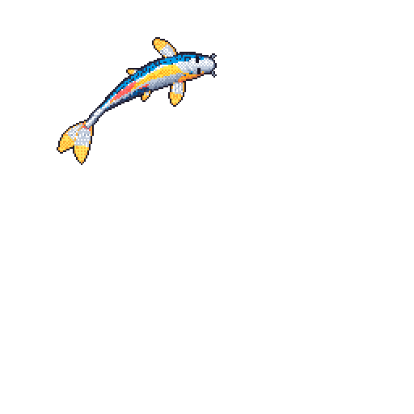

<table width="100%">
 <tr>
 <td width="64%" valign="middle">
 
RECRUITER SIGNAL BRIEF · thevoid0013

 <h1>Samyam Subedi</h1>
 <h2>Frontend or full-stack engineer</h2>
 
.NET developer building secure, multi-tenant fintech &amp; compliance systems. C# · ASP.NET Core · SQL Server · React. Kathmandu, Nepal.

 
<strong>● Building and sharing work in public</strong>

<a href="https://github.com/thevoid0013">GitHub</a> &nbsp;·&nbsp; <a href="https://samyamsubedi.netlify.app">Website</a>

 </td>
 <td width="36%" valign="middle" align="center">
 
 </td>
 </tr>
 </table>
 

<h2>What teams can evaluate quickly</h2>

<table width="100%">
 <tr>
 <td width="33%" valign="top"><h3>Role fit</h3>
Frontend or full-stack engineer · C# · HTML · CSS
</td>
 <td width="33%" valign="top"><h3>Public proof</h3>
10 repositories · 3 stars
</td>
 <td width="33%" valign="top"><h3>Momentum</h3>
634 contributions · 159 active days
</td>
 </tr>
 </table>

.NET developer building secure, multi-tenant fintech &amp; compliance systems. C# · ASP.NET Core · SQL Server · React. Kathmandu, Nepal.

<h2>Proof at a glance</h2>

<table width="100%">
 <tr>
 <td width="25%" align="center"><strong>10</strong> Repositories</td>
 <td width="25%" align="center"><strong>3</strong> Stars</td>
 <td width="25%" align="center"><strong>634</strong> Contributions</td>
 <td width="25%" align="center"><strong>7</strong> Followers</td>
 </tr>
 </table>

 <picture>
 <source media="(prefers-color-scheme: light)" srcset="https://www.gitskins.com/api/section/stats?username=thevoid0013&theme=github-dark&avatar=https%3A%2… />
 
 </picture>
 

<h2>Selected work</h2>

<table width="100%">
 <tr>
 <td width="58%" valign="top">
 <picture>
 <source media="(prefers-color-scheme: light)" srcset="https://www.gitskins.com/api/section/projects?username=thevoid0013&theme=github-dark&avatar=https%3… />
 
 </picture>
 </td>
 <td width="42%" valign="top">
 <h3><a href="https://github.com/TheVoid0013/DataImport">DataImport</a></h3>
 
A .NET solution: console app downloads/parses/upserts OFAC SDN data into SQL Server (MediatR, Serilog, caching), plus a Web API with paged endpoints a

 
C# · ⭐ 1 · 🍴 1

 
<a href="https://github.com/TheVoid0013/DataImport">Read the repository →</a>

 </td>
 </tr>
 </table>

<table width="100%">
 <tr>
 <td width="33%" valign="top"><h3><a href="https://github.com/TheVoid0013/MiniLedger">MiniLedger</a></h3>
MiniLedger is a .NET 10 payment ledger API (accounts, deposits, withdrawals, transfers, transaction history), built with DDD, CQRS-style mediator han

C# · ⭐ 1
</td>
 <td width="33%" valign="top"><h3><a href="https://github.com/TheVoid0013/blooming-flower">blooming-flower</a></h3>
A glowing night-time flower that blooms and sways, built with CSS animations only. JavaScript make this change colors.

SCSS · ⭐ 1
</td>
 <td width="33%" valign="top"><h3><a href="https://github.com/TheVoid0013/MonteCarloSimulator">MonteCarloSimulator</a></h3>
A server-rendered ASP.NET Core Razor Pages web application that uses PLINQ-based Monte Carlo simulations to demonstrate and analyze CPU-bound parallel

C# · ⭐ 0
</td>
 </tr>
 </table>

<h2>Technical toolkit</h2>

 <picture>
 <source media="(prefers-color-scheme: light)" srcset="https://www.gitskins.com/api/section/stack?username=thevoid0013&theme=github-dark&avatar=https%3A%2… />
 
 </picture>
 

<table width="100%">
 <tr>
 <td width="20%" align="center"><strong>C#</strong> 58% of public code</td>
 <td width="20%" align="center"><strong>HTML</strong> 15% of public code</td>
 <td width="20%" align="center"><strong>CSS</strong> 13% of public code</td>
 <td width="20%" align="center"><strong>JavaScript</strong> 9% of public code</td>
 <td width="20%" align="center"><strong>SCSS</strong> 5% of public code</td>
 </tr>
 </table>

<h2>Consistency signal</h2>

 <picture>
 <source media="(prefers-color-scheme: light)" srcset="https://www.gitskins.com/api/section/heatmap?username=thevoid0013&theme=github-dark&avatar=https%3A… />
 
 </picture>
 

## My Fish

 
 

---

<table width="100%">
 <tr>
 <td width="62%" valign="middle"><h2>Let’s talk about the next build</h2>
Open to thoughtful teams, ambitious products, and useful engineering work.
</td>
 <td width="38%" valign="middle" align="right"><a href="https://github.com/thevoid0013">GitHub</a> <a href="https://samyamsubedi.netlify.app">Website</a></td>
 </tr>
 </table>